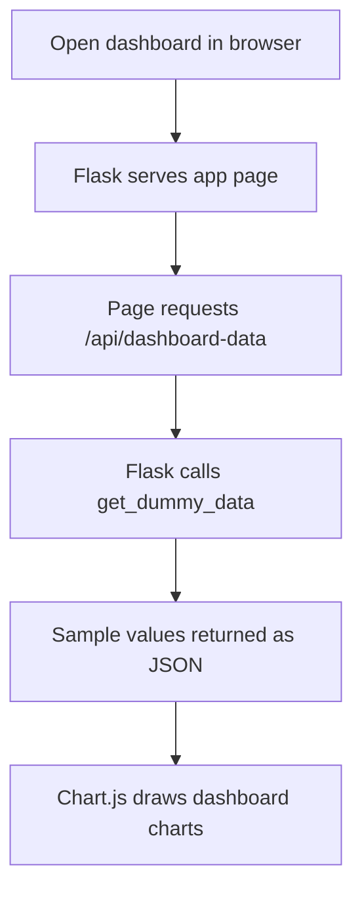

# Ansh Part 2: Dashboard Prototype

## What this part does

The Flask app in `app.py` serves a dashboard page and a `/api/dashboard-data` endpoint. In the supplied ZIP snapshot, the endpoint gets its values from `get_dummy_data()`. That makes this version a prototype using sample data; it does not show live results from the MySQL tables.

## Simple flow in the supplied snapshot



Plain-text version:

```text
Browser opens page -> Flask returns page -> page asks API for data
       -> API returns sample data -> Chart.js draws the charts
```

## Important version note

The downloaded ZIP labels `app.py` as a Phase-I dashboard skeleton and supplies sample values. Describe it as a dashboard prototype unless the actual Git repository contains a newer version that reads the real database. Do not claim database integration based only on this ZIP.

## What to check before committing

- Confirm the dashboard code in the real Git checkout is Ansh's work.
- Check whether the API returns sample data or real database results.
- If it is still sample data, label the charts as sample/demo data.
- If claiming a live dashboard, verify the data path from database query through Flask to the browser charts.

## Suggested separate commit

`docs: describe Flask dashboard prototype`

Only use this commit if Ansh reviewed the text and it accurately describes his contribution.
