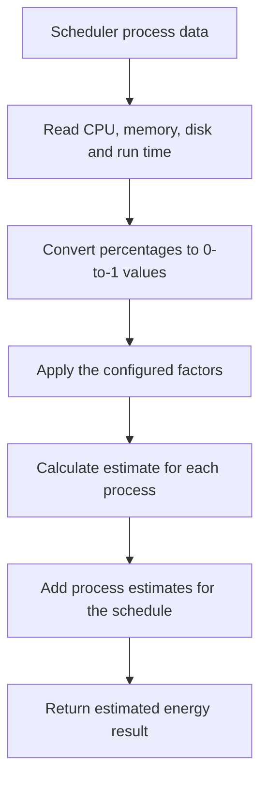

# Ansh Part 1: Energy Estimator

## What this part does

The estimator gives the scheduler a software estimate of energy use. It combines CPU use, disk activity, memory use, and run time with factors defined in `energy_estimator.py`. This is an estimate; it is not a physical power-meter reading.

## Simple flow



Plain-text version:

```text
Process and resource data
          |
          v
Normalize CPU and memory values
          |
          v
Apply time and resource factors
          |
          v
Estimate each process, then total the schedule
```

## Formula in plain words

```text
Energy estimate = CPU contribution + disk contribution + memory contribution
```

The source code defines the exact calculation and factors. Before presenting factor values as research-based, the team should cite and verify the sources behind them.

## What to check before committing

- Confirm `energy_estimator.py` is the version Ansh wrote or changed.
- Be ready to explain how each input affects the result.
- Keep the estimate clearly labeled as an estimate in the report and dashboard.
- Add or verify references for the factors if the report presents them as research values.

## Suggested separate commit

`docs: explain energy estimator flow`

Only use this commit if Ansh reviewed the text and it accurately describes his contribution.
